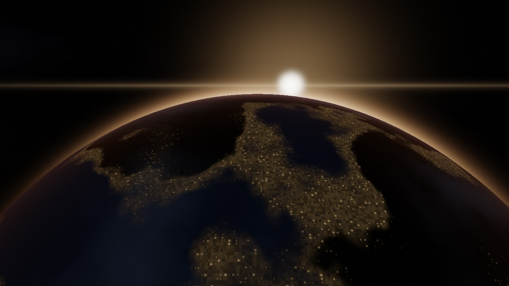
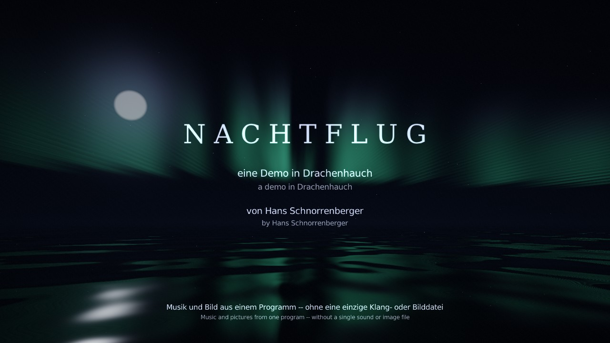
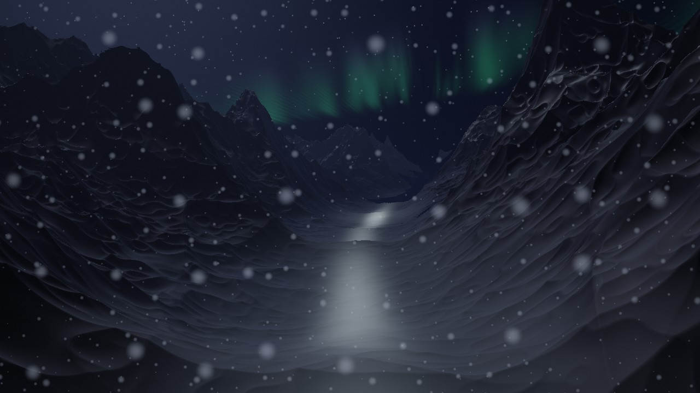
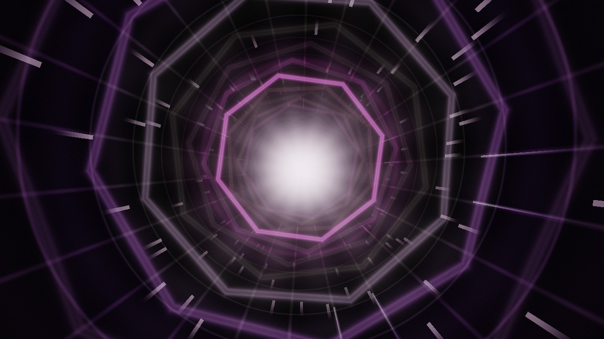
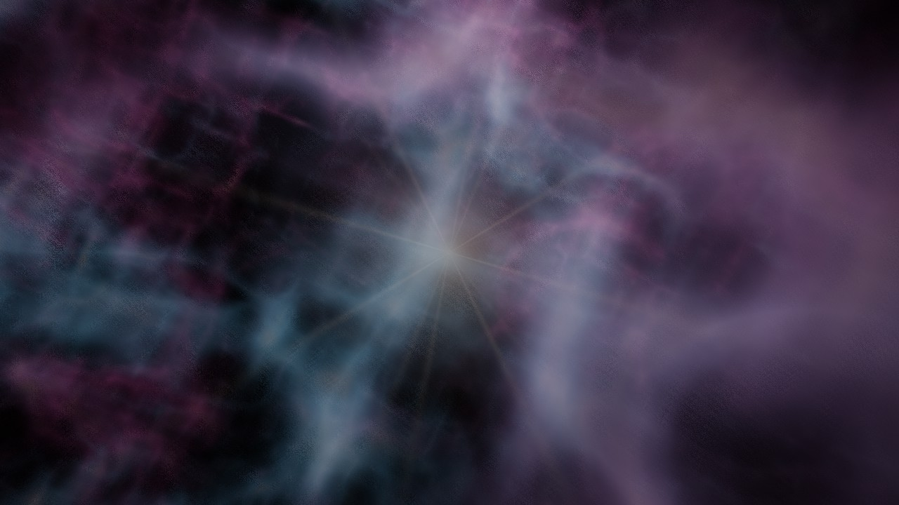
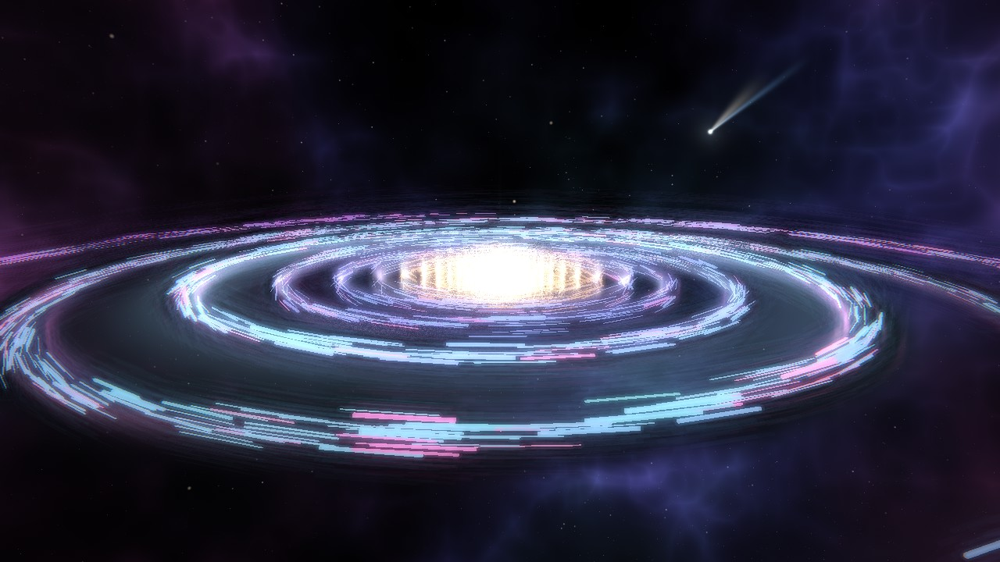
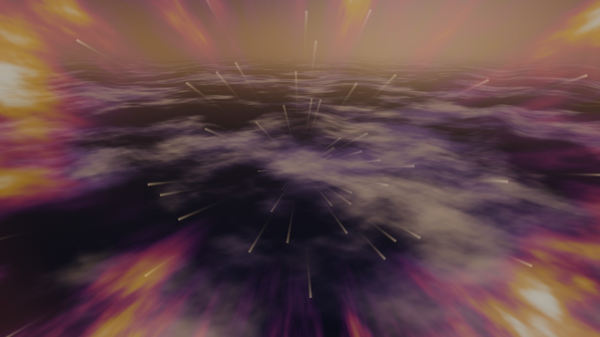
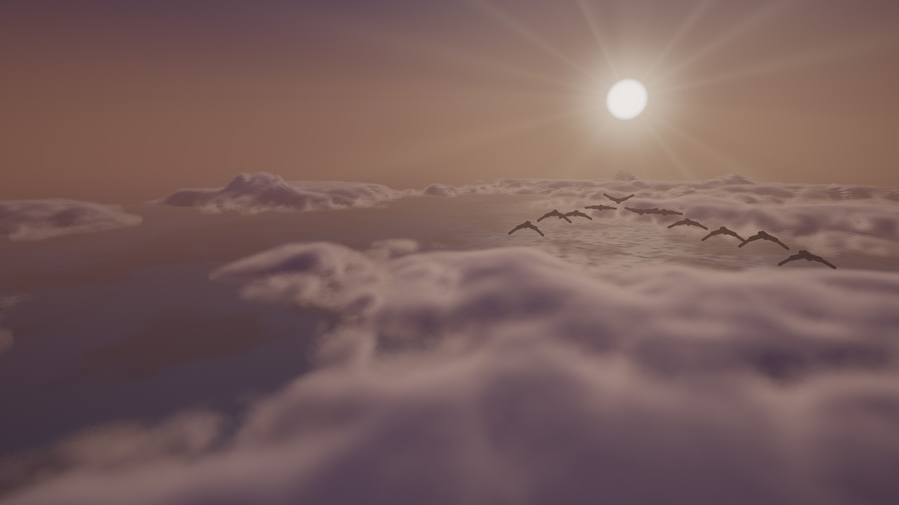
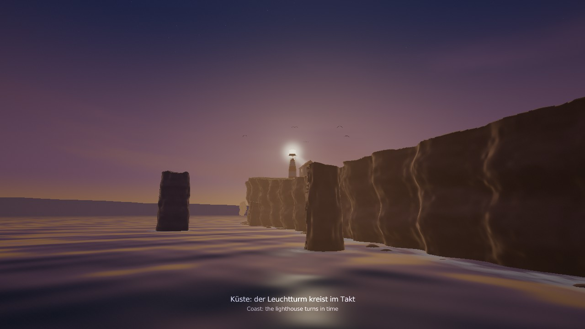
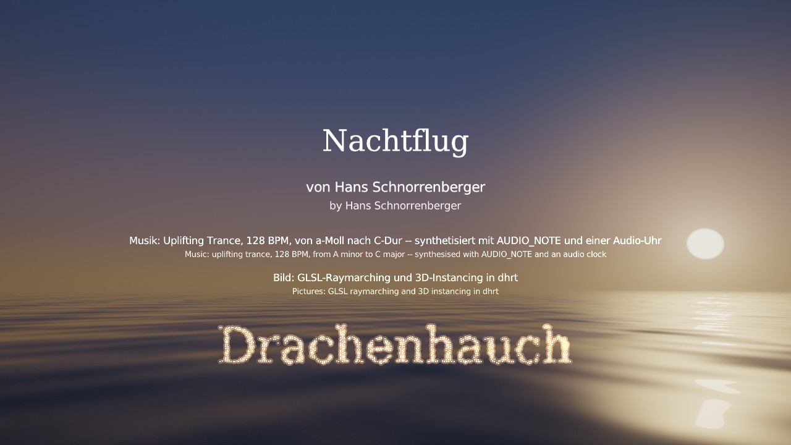

# Nachtflug

[English](README.md) · **Deutsch**

Eine Demo von Hans Schnorrenberger, geschrieben in
[Drachenhauch](https://github.com/HasoSchno70/Drachenhauch): Uplifting
Trance von a-Moll nach C-Dur, gut viereinhalb Minuten. Eine Reise vom
nächtlichen Meer über die Berge durch einen Lichttunnel ins All zur Galaxie
-- und wieder heim: Erdaufgang im Orbit, Wiedereintritt, über den Wolken mit
einem Zug Wildgänse, an der Küste mit dem Leuchtturm vorbei, bis die Sonne
über dem Meer aufgeht. Jede Szene hat ihre eigenen Geräusche -- Meer, Wind,
Grollen, Gänse, Brandung, Möwen, ein Nebelhorn. Musik, Geräusche und Bild
entstehen alle im Programm selbst: es steckt keine einzige Klang- oder
Bilddatei darin.

**▶ Im Browser ansehen: https://hasoschno70.github.io/Nachtflug/**

Einmal klicken zum Starten (Browser spielen Ton erst nach einem Klick),
Kopfhörer aufsetzen, ⛶ für Vollbild. Beim ersten Mal lädt die Seite etwa
20 MB.

## Die Reise

| | |
|---|---|
|  |  |
| **Ozean bei Nacht** -- Polarlicht, Mondglitzern, Sternschnuppen | **Tiefflug** durch ein Tal, ein Fluss aus Licht, fallender Schnee |
|  |  |
| **Lichttunnel** -- Neonringe rasen im Takt vorbei | **Sternennebel** -- der Breakdown, eine Stimme: „Schließ die Augen“ |
|  |  |
| **Galaxie** aus 2.600 Lichtspuren, ein Komet, die Rückung | **Erdaufgang** -- Stadtlichter, der leuchtende Rand der Atmosphäre, die Sonne geht über dem Erdrand auf |
|  |  |
| **Wiedereintritt** -- Plasma glüht mit der Bassdrum | **Über den Wolken** -- ein Wolkenmeer, Wildgänse ziehen der Sonne entgegen |
|  |  |
| **Küste** -- Klippen, Brandung, ein Leuchtturm kreist im Takt | **Tagesanbruch** auf dem Meer, wo alles begann; ein Funkenschwarm schreibt „Drachenhauch“ |

## Wie es gemacht ist

* **Musik:** Note für Note synthetisiert (`AUDIO_NOTE`, `AUDIO_SFX`) und auf
  einer Audio-Uhr gespielt: Supersaw-Lead, Klavier, ein Chor aus Obertönen
  und Formanten, Flächen, die unter der Bassdrum pumpen, ein Trance-Gate,
  eine Rückung im Finale, und auf dem Heimweg hellt die Harmonie von a-Moll
  nach C-Dur auf. Die Stimme kommt aus der Sprachausgabe des Systems,
  geschichtet und mit Echo.
* **Geräusche:** gefiltertes Rauschen und Noten -- der Gänseruf zum Beispiel
  ist wie der Chor gebaut: Obertöne, gewichtet mit nasalen Formanten, und ein
  schnelles Schnarren in der Stimme.
* **Bilder:** jede Szene ist ein Fragment-Shader (Raymarching durch Gelände,
  Wolken als Volumen, Klippen und Leuchtturm als Distanzfelder); die Galaxie
  ist eine echte 3D-Szene, gezeichnet in einem einzigen Instancing-Aufruf.
* **Alles folgt der Musik:** was pulsiert, pulsiert mit der Bassdrum, was
  aufblitzt, blitzt mit der Melodie, die Farben folgen den Akkorden, und die
  Szenen wechseln durch Licht.

## Was in diesem Repository liegt

Die Browser-Fassung: die Drachenhauch-Laufzeit `dhrt` als WebAssembly
(`dhrt.wasm`, `dhrt.js`, `dhrt.data` mit den Shadern) und die Quelle
`program.dh`, die beim Start im Browser übersetzt wird. Zum Ausprobieren auf
dem eigenen Rechner den Ordner mit einem beliebigen statischen Webserver
ausliefern, etwa `python -m http.server`, und die Seite öffnen.

Die Lizenzen der in `dhrt.wasm` enthaltenen Bibliotheken stehen in
[THIRD-PARTY-NOTICES.txt](THIRD-PARTY-NOTICES.txt).
